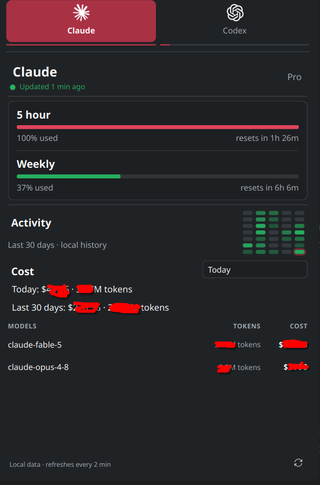
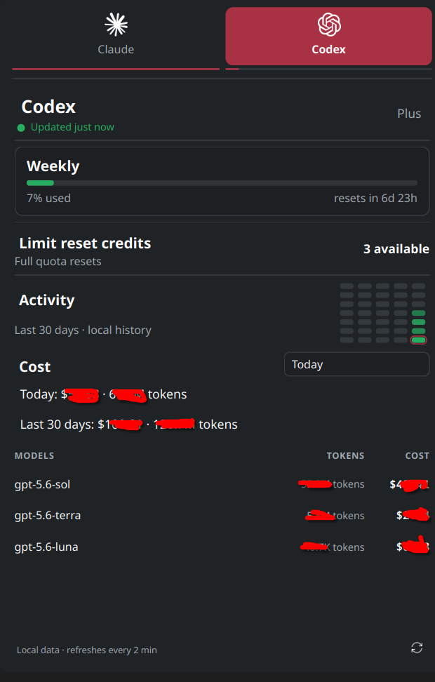
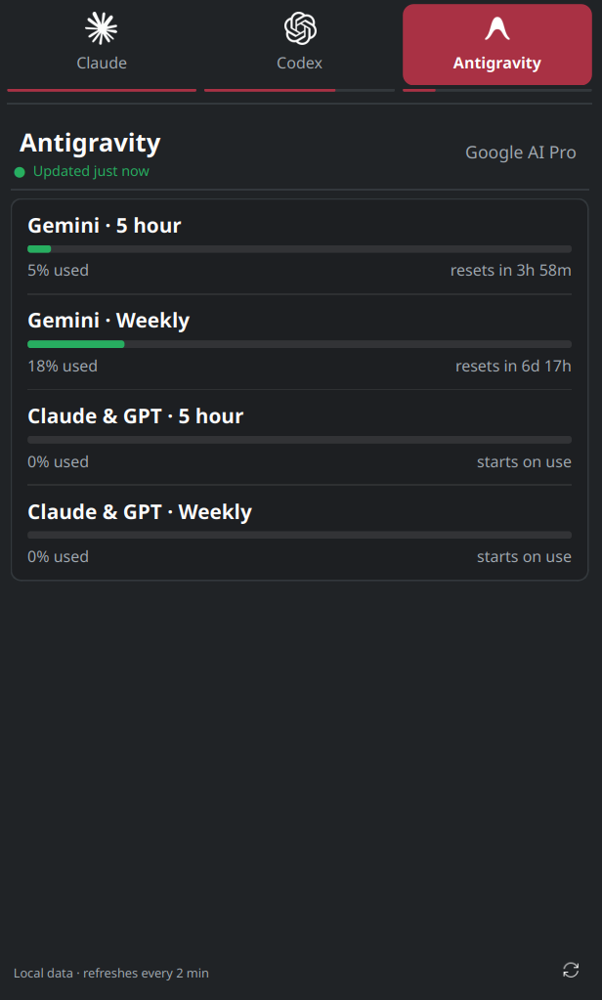

# AI Usage Bar

A tiny KDE Plasma tray utility for Claude Code, OpenAI Codex, and Google Antigravity quota windows. It reads the
existing local sessions for each provider, fetches their usage endpoints every two minutes, and keeps all data in
memory. Five-hour, daily, weekly, model-specific Codex lanes, and Antigravity model family buckets are supported
whenever the provider reports them. There is no account setup, database, analytics, helper daemon, or
browser-cookie access.

## Screenshots

<p align="center">
  
  
  
</p>

The popup keeps the important details within reach: live quota windows and reset times, plan status,
reset credits, local cost and token totals, per-model breakdowns, selectable daily history, and a compact
activity grid. Screenshots use redacted local usage values.

## Run

Requirements: Linux, Python 3.11+, PyQt6, and KDE Plasma (tested on Plasma 6 / Wayland).

```bash
./ai_usage_bar.py
```

Click the tray meter for the compact details popup. The fixed-size provider switcher opens on Claude
and switches between Claude, Codex, and Antigravity without moving or resizing the popup; right-click
the tray icon for refresh and quit. A runtime lock ensures only one copy can run per desktop session.

## Install and start at login

```bash
./install.sh
./install-codexbar-helper.sh  # optional exact local cost/model breakdowns
ai-usage-bar
```

The installer copies the one-file application under `~/.local/share`, adds a launcher in
`~/.local/bin`, and enables a standard XDG autostart entry. Run `./uninstall.sh` to remove it.
The optional official CodexBar CLI helper is invoked only for local cost scans and exits afterward;
it is not another resident service. Cost results are cached for ten minutes.

## Privacy and credentials

The app reads `~/.claude/.credentials.json`, `~/.codex/auth.json`, and local Antigravity OAuth token files
(`~/.t3/userdata/providers/antigravity/*/antigravity-acp/acp_token.json`, `antigravity-oauth-token`, or
`ANTIGRAVITY_TOKEN_PATH`) without modifying them. Tokens are used only as authorization headers for
`api.anthropic.com/api/oauth/usage`, `chatgpt.com/backend-api/wham/usage`,
`daily-cloudcode-pa.googleapis.com`, and `cloudcode-pa.googleapis.com` (plus `oauth2.googleapis.com/token`
in memory when refreshing an Antigravity refresh token). They are never logged or stored by this app. If a
session expires, sign in again with `claude`, `codex login`, or Antigravity; the next refresh picks up the
new credentials.

## Test

```bash
python3 -m unittest discover -v
```
